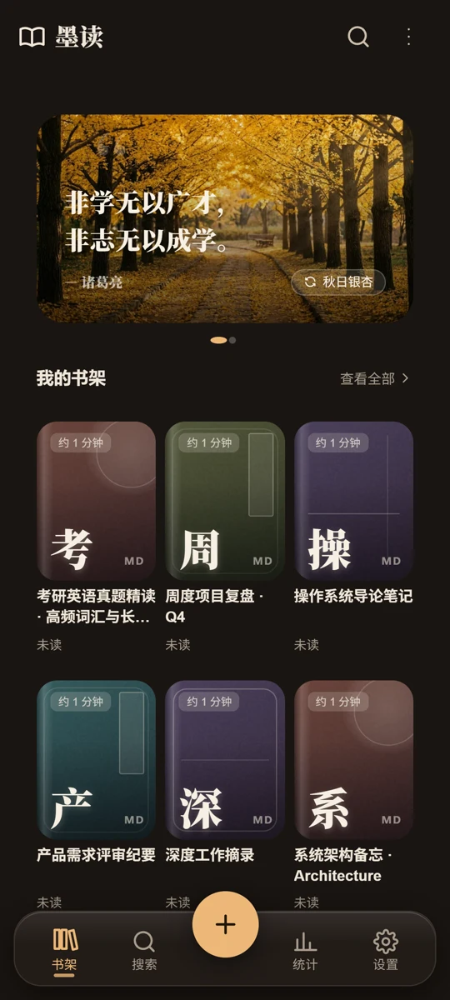
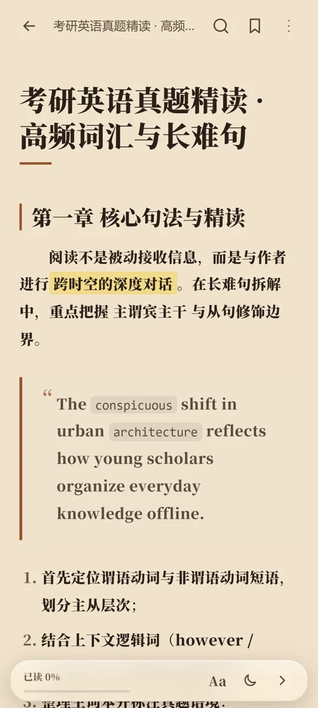
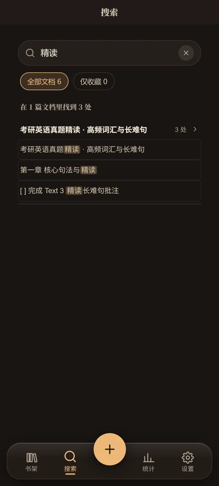
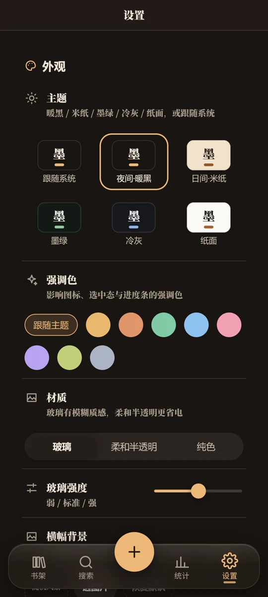

<div align="center">

# 墨读 Mdlego

**100% 离线的 Android 轻量 Markdown 书架与文件管理器**

`~14 MB` · 零广告 · 零账号 · 无联网权限

[](https://github.com/Yuvzol0932/Mdlego/releases/latest)
[](https://github.com/Yuvzol0932/Mdlego/releases)
[](https://github.com/Yuvzol0932/Mdlego/releases)

[](LICENSE)

</div>

---

## 下载与安装

- **正式版下载**：[GitHub Releases Latest](https://github.com/Yuvzol0932/Mdlego/releases/latest)
- **最新尝鲜版（含最新视觉与手势迭代）**：[全部发行版 / Pre-release](https://github.com/Yuvzol0932/Mdlego/releases)

> 安装说明：
> - 支持 **Android 8.0+（API 26+）**，安装包约 **14 MB**，开箱即用。
> - 支持从系统文件管理器多选导入，或从任意应用「分享」传入 `.md` / `.markdown` / `.txt` 文档（单文件上限 10 MB）。
> - 全应用 **不申请 `INTERNET` 权限**，安装后可彻底断网运行。

---

## 界面一览

<div align="center">
<table>
  <tr>
    <td align="center"><br /><sub><b>口袋书架 · 暖黑</b></sub></td>
    <td align="center"><br /><sub><b>杂志精读 · 米纸</b></sub></td>
    <td align="center"><br /><sub><b>全库秒级检索</b></sub></td>
    <td align="center"><br /><sub><b>6 套纸感主题</b></sub></td>
  </tr>
</table>
</div>

---

## 核心特性

### 口袋书架与文件管理
- **无痛导入与去重**：支持多文件导入与第三方应用分享流入，按内容 SHA-256 自动去重，不覆盖已有阅读进度与批注。
- **高辨识度装帧书封**：内置 **12 套色板 × 6 种装帧版式**（典雅框线 / 杂志腰封 / 几何日轮 / 斜切色块 / 极简排印 / 古籍题签），支持为每篇文档单独编辑封面配色、版式、徽标文字与自定义图片。
- **有序归档与秒级检索**：支持文件夹、多标签与收藏筛选；支持按文档分组与关键词高亮的**全库检索**，并提供精选风景横幅与经典名言随机轮播（可自定义本地横幅与语录）。

### 杂志级纸感精读与批注
- **纸感主题与精致排版**：精选 **6 套高区分度主题**（夜间·暖黑 / 日间·米纸 / 墨绿 / 冷灰 / 纸面 / 跟随系统）、8 色强调色与玻璃/柔和/纯色材质；支持字号、行距、段距与宋体/黑体切换，配备护眼暖色层。
- **完整 Markdown 与交互体验**：支持 CommonMark + GFM（表格横滚、代码高亮与一键复制、`==高亮==`、可勾选并带描边动效的任务清单）；原文 HTML 仅转义不执行。
- **划词批注与 10 万词离线查词**：四色荧光划线、下划线、删除线与笔记批注，跨缩放精确锚点重定位；内置约 10 万词条离线英汉词典（含音标、释义与词形还原），支持生词本与查词历史。

### 编辑、备份与阅读统计
- **随时修改原文**：支持编辑/预览分栏与未保存保护；原生通道写回原文件前进行指纹校验，存在外部修改时给出「覆盖 / 另存副本 / 取消」提示。
- **多端导出与本地统计**：内置系统 TTS 语音朗读（高亮当前段落）、导出独立 HTML、系统打印/导出 PDF；记录本地今日时长、连续阅读天数与近 7 日柱状图。
- **精确进度记忆**：退出、返回或调整字号后重新打开，依然精准回到原阅读位置。

### 原生级动效与手势
- 书架与阅读页采用 **书封 FLIP 形变开合转场**，配合 Android 14+ **预测式返回圆角缩窗手势**，过程流畅顺滑。
- 内置全局错误边界与本地诊断日志导出（不含正文与隐私笔记）。

---

## 数据与隐私

本应用 **不申请 `INTERNET` 权限**，没有任何账号系统、联网请求或远端埋点。文档内容、批注标记、任务清单与阅读统计全部保存在手机本地（`IndexedDB` / `localStorage`），换机时可通过**设置 → 备份与恢复**导出并校验还原本地 JSON 整库。

---

## 开发与构建

- **技术栈**：Capacitor 8 · Vite 8 · TypeScript 5.9 · markdown-it 15 · Vitest 5（除 Capacitor 与 markdown-it 外，**运行时零第三方依赖**）

```bash
npm install

npm run dev            # 启动 Vite 开发服务器
npm run verify         # 四道代码门禁 + 类型检查 + 单元测试 + 生产构建
npm run smoke          # 无头 Chrome 移动端尺寸冒烟测试
npm run android:build  # Web 构建 → 同步资源 → Gradle 打包 → 产物布局与 APK 校验
```

<details>
<summary><b>工程约束、环境要求与已知限制（点击展开）</b></summary>

#### 自动化门禁（失败将直接阻断 `verify`）
| 命令 | 拦截范围 |
| :--- | :--- |
| `check:boundaries` | `core` 反向依赖 `data`/`views`；视图层直接访问 `indexedDB` |
| `check:state` | 视图层绕过 `dispatch` 直接篡改 `state` 属性 |
| `check:selectors` | 非视图层使用裸 CSS 选择器绑定逻辑 |
| `check:tokens` | 令牌文件外出现硬编码色值，或非玻璃层使用模糊滤镜 |

#### 本地构建环境
- **Node.js**：`^22.22.2 || ^24.15.0 || >=26`
- **JDK**：21
- **Android SDK**：Platform 36 + Build Tools 36（本地路径在 `android/local.properties` 中配置，含中文工作路径需保留 `android.overridePathCheck=true`）
- **Gradle**：`8.14.3`

#### 已知限制
- 正文采用长文流式滚动排版，暂未实现拟真左右翻页。
- 单个导入文档上限 `10 MB`（支持 `.md` / `.markdown` / `.txt`，自动识别 UTF-8 / GBK）。
- 跨设备迁移依赖本地 JSON 导出与恢复，不提供云同步或 WebDAV。

</details>

---

## License

[MIT](LICENSE)
